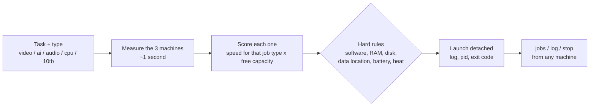
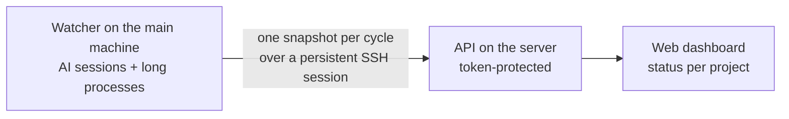

# Multi-machine AI workshop

Three always-on machines working as one workshop. A job router sends each heavy task to the best machine, and a live dashboard shows what every AI coding session and long job is doing.

## The problem

Every heavy job (video renders, transcription, source separation) landed on the same small server that also runs the AI coding sessions. That server risked running out of memory, which would have taken every session down with it, while a much faster Mac sat idle.

## The machines

| Machine | Role |
|---|---|
| Ubuntu mini PC (i5, 16 GB) | Hosts the AI coding sessions (Claude Code) and the audio tools |
| Mac M4 (16 GB) | Video and AI work on its GPU (MLX/MPS), DaVinci Resolve and Adobe |
| Home server (i5, 16 GB + 10 TB) | Web services and the media archive |

All three are connected by Tailscale over 1 Gbps wired Ethernet.

## Job router

- The score combines how fast each machine is for that type of job (measured, not guessed) with how much capacity it has free right now. It keeps headroom for the interactive sessions and for the web services.
- Some rules are fixed, for example DaVinci goes to the Mac, and short jobs stay where the data is.
- On the main machine each job runs with a memory cap and low priority. The Mac is kept awake until the job ends.
- Measured on 1080p H.264: the Mac encodes about **3.7× faster** than the server, and AI models run several times faster on its GPU.

## Live dashboard

- **For each AI session:** working, waiting for an answer, asked a question or stopped on an error, plus the current step.
- **For each long process:** a readable name, progress and an estimated end time, taken from its own log.
- **Privacy:** the dashboard never shows the conversation content. Only a token stored on the server can write to it, and if the watcher goes silent for 2 minutes the page says so.

## Stack

Python · bash · SSH · systemd-run (memory caps) · tmux · Tailscale · ffmpeg · MLX / PyTorch MPS · a small web API and dashboard

---

The source code is private because it runs on my own infrastructure. I'm happy to walk through it on a call.

© 2026 Jheremyt Salazar. All rights reserved.
